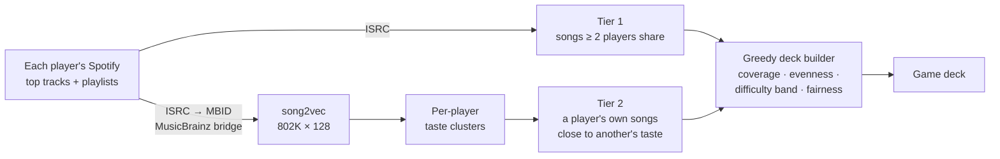

# hitster-maker

A multiplayer music game in the style of *Hitster* (hear a song, place it on your timeline by
release year), where the deck is built from **what the players at the table actually listen
to**. Each player connects Spotify; the backend finds the songs the group shares and builds a
deck in which everyone knows a similar share of the cards.

The interesting part is what happens when shared songs run out. Spotify no longer gives
third-party apps any notion of song similarity, so I trained one:

> **[song2vec](docs/song2vec.md)**: a word2vec skip-gram embedding of **802,724 songs**,
> learned from ListenBrainz listening histories (each user's week of listening is one
> "sentence"). It drives each player's taste clusters and the deck builder's fallback tiers.
> Intrinsic evaluation: a song's 10 nearest neighbours share its artist 44% of the time,
> against 0.01% at random, and the neighbourhoods also follow genre and era. They are
> noticeably biased by popularity, which the write-up discusses.

## How it works



- **[song2vec.md](docs/song2vec.md)**: data, model, the ID bridge, how the game uses the
  space, evaluation, limitations and next steps.
- **[deck-builder.md](docs/deck-builder.md)**: the greedy, fairness-driven deck builder.
- **[architecture.md](docs/architecture.md)**: backend layers, game flow, persistence,
  the taste-analysis tool.
- **[decisions.md](docs/decisions.md)**: the design choices and why.

## Repository layout

```
backend/     FastAPI (Python 3.12): routers → pipeline (the algorithm) → services
frontend/    Vue 3 + TypeScript: lobby, game, and the /analysis tuning tool
notebooks/   embedding training (Kaggle, gensim)
scripts/     ISRC ↔ MBID bridge builders (MusicBrainz dump) and the embedding evaluation
docs/        write-ups (above)
```

## Running it

Running it needs three things that are not in this repository:

1. **The model artifacts (~2.5 GB) in `models/`**, which are too large for git. Rebuild them:
   - `item2vec.wordvectors.vectors.npy`, `mbid_to_idx.json`, `idx_to_mbid.json`: from
     [`notebooks/train_item2vec.ipynb`](notebooks/train_item2vec.ipynb), run on a ListenBrainz
     sentence file.
   - `isrc_bridge.db`: `python scripts/build_isrc_bridge.py --mbdump <dir>`, then
     `python scripts/build_mbid_meta.py --mbdump <dir>`, using a MusicBrainz database dump.
   - `mbid_popularity.parquet`: unique listeners per recording, from the same ListenBrainz
     data.
2. **A Spotify developer app.** Add `http://127.0.0.1:8000/auth/spotify/callback` as a
   redirect URI, copy `backend/.env.example` to `backend/.env`, and fill in the credentials.
   In development mode, every player's account must be added under *User Management*.
3. **Spotify Premium** for in-game playback (Web Playback SDK).

```bash
docker compose up --build
```

Open <http://localhost:5173>. The API runs on <http://127.0.0.1:8000> (docs at `/docs`).

### Tests

```bash
cd backend
pip install -r requirements.txt -r requirements-dev.txt
pytest
```

The tests cover matching, the clustering algorithm, the deck builder end to end on synthetic
groups (fairness, exclusions, relaxation, bridge tier), and play-history persistence. They need
none of the model artifacts. CI runs them along with the frontend type-check.

## Credits

Built in summer 2026 by Émile Jacques-Tighe. Data: [ListenBrainz](https://listenbrainz.org)
and [MusicBrainz](https://musicbrainz.org) open data dumps. Not affiliated with *Hitster* or
Spotify.
