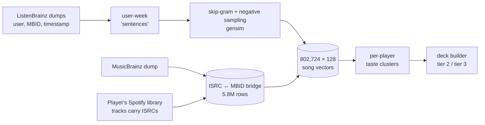

# song2vec — learning song embeddings from listening histories

hitster-maker builds a Hitster-style music game deck out of the songs a group of friends
actually listens to. The easy part is the songs two players **share**: you intersect their
Spotify libraries. The hard part is everything else. Most pairs of people share only a few
dozen songs, and a fair deck needs some notion of *"player B probably knows this song of
player A's"* across hundreds of thousands of songs neither has ever saved.

Spotify no longer gives third-party apps that signal (no recommendations, audio features or
popularity for new apps), so I learned it myself: a **128-dimensional embedding of 802,724
songs**, trained on public listening histories with the word2vec skip-gram objective. In
this space, songs that the same people listen to in the same week end up close together.
This document covers how it was built, how the game uses it, what it actually learned, and
where it falls short.

---

## 1. Data: listening histories as sentences

**Corpus.** [ListenBrainz](https://listenbrainz.org) publishes every listen its users
scrobble: `(user, recording MBID, timestamp)`. The MBID is a MusicBrainz recording
identifier, a platform-neutral ID for one specific recording. I used one month of
data: the 30 daily incremental dumps from 10 May to 9 June 2026 (reasoning in
[decisions.md](decisions.md)).

**What counts as a sentence.** Item2Vec ([Barkan & Koenigstein, 2016][item2vec]) applies
word2vec to any sequence of items, so the main modelling decision is what to treat as a
"sentence". I compared three options:

| Context | Captures | Typical length |
|---|---|---|
| **one user's listens in one calendar week** ✅ | "same taste world" | 20–200 songs |
| a listening session (30-min gap) | "same playlist" | 3–15 songs |
| fixed sliding window of N listens | position in history only | N |

I chose weekly windows. The game cares about **familiarity**: whether you would recognize a
song is a property of your broader taste, not of which track came right after which. It is
also the context MetaBrainz uses for its own models on this data.

**Preprocessing.** A separate Kaggle notebook (not included here) turns the raw dumps into a
sentence file: one user-week per line, space-separated MBIDs. That step was designed to
drop listens with no MBID, drop sentences shorter than 3 songs, and cap very long ones, so
that one user's 2,000-listen week can't dominate the co-occurrence statistics. Training then
keeps only songs that appear at least `min_count = 20` times.

The result is **~102.7M song tokens over a vocabulary of 802,724 recordings**. The
distribution is very long-tailed: the median song appears 49 times, the 99th percentile
about 1,350 times, and the most frequent 53,416 times.

## 2. Model

This is skip-gram with negative sampling (SGNS; [Mikolov et al., 2013][w2v]). Each song $s$
has an input vector $v_s$ and a context vector $u_s$. For every pair of songs $(s, c)$ that
co-occur within the context window of a user-week, the model maximizes

$$
\log \sigma(u_c^\top v_s) \;+\; \sum_{i=1}^{k} \mathbb{E}_{n_i \sim P_n}\big[\log \sigma(-u_{n_i}^\top v_s)\big]
$$

where $P_n \propto \text{freq}^{3/4}$ is the usual noise distribution. Frequent songs are
also randomly dropped from sentences (subsampling with threshold $t$), the same way word2vec
handles stop-words. Without that, globally viral songs would look "related" to everything.

Skip-gram rather than CBOW was a deliberate choice. Music catalogues are long-tailed, and
CBOW averages the context, which washes out rare items. Skip-gram gives every occurrence of
a rare song its own training signal.

| Hyperparameter | Value | Why |
|---|---|---|
| objective | skip-gram (`sg=1`), negative sampling | long-tailed catalogue (above) |
| `vector_size` | 128 | standard size for a vocabulary this large |
| `window` | 10 | weekly sentences are long, so a wide window |
| `negative` | 10 | $k$ above |
| `sample` | 1e-4 | the usual word2vec subsampling threshold $t$ |
| `min_count` | 20 | rarer songs give noisy vectors |
| `epochs` | 5 | the usual word2vec default |

Training is in [`notebooks/train_item2vec.ipynb`](../notebooks/train_item2vec.ipynb) (gensim
4.4.0). The full run (five epochs plus exports) took about 1 h 50 min on a 4-worker Kaggle CPU
session (word2vec gains nothing from a GPU), with a checkpoint saved after each epoch to survive
Kaggle's session limits. The repo only uses the exported artifacts in `models/`: the vector
matrix and the `MBID ↔ row index` maps, plus a per-MBID popularity table (unique listeners,
computed from the same dumps). The notebook also builds an Annoy index, but the backend does
exact search instead: one 802K × 128 matrix-vector product takes a few milliseconds.

## 3. Connecting two ID systems

The embedding uses MusicBrainz IDs, while Spotify uses its own track IDs, so neither side
knows about the other. The shared key is the **ISRC**, the industry-standard
recording code that both Spotify and MusicBrainz store.

- **Inbound (player → embedding).** Every Spotify track in a player's library carries its
  ISRC. [`scripts/build_isrc_bridge.py`](../scripts/build_isrc_bridge.py) joins the
  MusicBrainz `recording` and `isrc` tables into a 5.8M-row SQLite map, ISRC → MBID.
- **Outbound (embedding → playable card).** A neighbour found in the embedding is just an
  MBID. [`scripts/build_mbid_meta.py`](../scripts/build_mbid_meta.py) builds a one-row-per-MBID
  table (ISRC, title, artist credit) for the whole vocabulary, and
  [`track_resolution.py`](../backend/app/pipeline/track_resolution.py) turns it into a
  playable Spotify track. It tries the cache first, then an ISRC search, then a cleaned-up
  `track:/artist:` text search (titles like *"… - Remastered 2011"* break exact search).
  Every result is cached, release year included, so later games make no API calls.

Coverage is the main constraint. About 61% of the vocabulary has a MusicBrainz ISRC, and
anything outside the vocabulary (fewer than 20 occurrences in the corpus) has no vector at
all.

## 4. How the game uses the embedding

All of this sits in the "fallback" tiers of the deck builder
([`pipeline/deck.py`](../backend/app/pipeline/deck.py), full description in
[deck-builder.md](deck-builder.md)). Real shared songs always come first. The
embedding is only consulted when those run out or the deck is unfair to one player.

**Per-player taste clusters.** One average vector per player would put someone who listens
to both metal and jazz somewhere between the two, a region that matches neither. Instead,
each player's in-vocabulary songs are clustered with average-linkage agglomerative
clustering on cosine distance, cut at a single global threshold (`0.7`), and clusters
smaller than 30 songs are discarded as noise
([`embedding_service.agglomerate_taste_clusters`](../backend/app/services/embedding_service.py),
implemented in NumPy with the Lance–Williams update). Because the threshold is the same for
everyone, the number of taste zones is an *output*. A player with eclectic taste gets more
zones than one with narrow taste, and a zone is equally tight for every player. An earlier
version used k-means with a hand-picked k. I compared the two in a purpose-built
[taste-analysis tool](architecture.md#the-taste-analysis-tool-analysis) before switching.

**Tier 2: bridge songs (live).** When player B is falling behind, take the songs only B
owns and score each one by its cosine similarity to the nearest taste-zone centroid of
another player A:

$$
\text{prox}(s) = \max_{A \neq B,\; j} \cos\!\big(v_s,\; c_{A,j}\big)
$$

The song enters as a candidate crediting B with their real, measured weight and A with an
*estimated* weight of $0.5 \cdot \text{prox}(s)$. One side of every such card is grounded
in a real library.

**Tier 3: synthetic songs (built, deliberately switched off).** Blend each close pair of
centroids from different players (normalized mean, cosine ≥ 0.3). Pull the 200 nearest
songs to each blend, keep only those above a popularity gate (roughly ≥ 220 unique
listeners) *before* making any Spotify call, and credit every player an estimate
proportional to their proximity, with no player's total allowed to be more than 30%
synthetic. It is disabled because no player owns these songs, so the worst case is a card
nobody at the table recognizes. I don't yet have evidence of how often that happens (see §6).

## 5. What the embedding actually learned

Embeddings like this have no ground-truth accuracy, so I ran two intrinsic checks and looked
at the neighbourhoods by hand. Everything below is reproducible with
[`scripts/evaluate_embeddings.py`](../scripts/evaluate_embeddings.py) (1,000 random query
songs, fixed seed).

| Query songs | same-artist among 10 nearest | random baseline | corr(log-pop of song, of its neighbours) |
|---|---|---|---|
| all | **0.44** | 0.0001 | **0.84** |
| popular (≥ 200 listeners) | **0.71** | 0.0001 | 0.39 |

**It captures co-listening strongly, and mostly by artist.** A song's nearest neighbours
are by the same artist 44% of the time, which is about 4,000× chance. For popular songs it
is 71%: *Smells Like Teen Spirit*'s 10 nearest neighbours are all Nirvana. This makes sense,
because people tend to binge one artist within a week. In practice, raw nearest-neighbour
search mostly answers "more by this artist".

**Beyond the artist, the neighbourhoods follow genre and era.** Nearest songs by *other*
artists:

| Query | Nearest other-artist neighbours |
|---|---|
| Smells Like Teen Spirit — Nirvana | Killing in the Name (RATM) · Song 2 (Blur) · Black Hole Sun (Soundgarden) |
| Dancing Queen — ABBA | I Will Survive (Gloria Gaynor) · Stayin' Alive (Bee Gees) · Y.M.C.A. (Village People) |
| Blinding Lights — The Weeknd | Don't Start Now (Dua Lipa) · Watermelon Sugar (Harry Styles) |
| HUMBLE. — Kendrick Lamar | Mask Off (Future); the rest are Kendrick collaborations |

None of genre, era or language was given to the model. All of it came out of who listens
with whom.

**It is organised by popularity as well as by taste.** The correlation of 0.84 means that
rare songs sit next to rare songs and hits next to hits. This is the well-known frequency
bias of word2vec-style embeddings ([Gong et al., 2018][frage]; [Mu & Viswanath, 2018][abtt]).
For a game whose cards have to be *recognizable*, it is a real problem. It is why the
synthetic tier needs a separate popularity gate instead of trusting proximity alone.

**The corpus is small, and its biases show.** The most popular song in the dumps has only
2,246 unique listeners, so the space reflects a few thousand fairly technical ListenBrainz
users, not the general public. It also covers a single month, so it reflects what people
played in spring 2026: an older song only has a vector if someone still listens to it. You
can see the small size in the noise: an internet novelty song (*Magical
Trevor*) among Nirvana's nearest neighbours, or a Turkish rock song next to *Bohemian
Rhapsody*. A few heavy listeners with unusual combinations are enough to bend a neighbourhood.

## 6. Limitations and what I would do next

1. **Measure it on the task that matters.** The checks above are intrinsic. The question
   the game actually needs answered, and the reason tier 3 is off, is *would this group
   recognize this song?* The natural experiment is to log recognition per card during play,
   then compare tier 1, tier 2 and tier 3 cards as a function of proximity and popularity.
   An offline proxy: hold out each user's next week of listening and report recall@k of
   embedding retrieval.
2. **Separate taste from popularity and from artist.** Try post-processing (removing the
   dominant principal components, as in [all-but-the-top][abtt]), frequency-adversarial
   training ([FRAGE][frage]), or artist-aware negative sampling, so that "near" means
   *similar taste* rather than *same artist* or *equally obscure*. Then check whether
   cross-artist retrieval improves.
3. **Ablate the context definition.** Weekly vs. session windows was decided on priors
   ([decisions.md](decisions.md)). Training both and comparing them on the
   held-out metric above would settle it.
4. **Train on more data.** ListenBrainz publishes years of history and this model uses one
   month of it. More months would give rarer and older songs enough occurrences, and would
   weaken the influence of any single heavy listener.
5. **Cold start.** Songs below `min_count`, and the ~39% of the vocabulary with no ISRC, are
   invisible to the game. A content-based audio encoder aligned to this co-listening space
   (contrastively) could place them.
6. **Group selection as optimisation.** The deck builder is a hand-tuned greedy over a
   weighted sum (coverage, evenness, difficulty band, fairness gap). Framing it as a
   constrained or fair subset-selection problem would make its trade-offs explicit, and
   could give guarantees the greedy loop doesn't.

---

### References

- O. Barkan, N. Koenigstein. *Item2Vec: Neural Item Embedding for Collaborative
  Filtering.* IEEE MLSP, 2016. [arXiv:1603.04259][item2vec]
- T. Mikolov, I. Sutskever, K. Chen, G. Corrado, J. Dean. *Distributed Representations of
  Words and Phrases and their Compositionality.* NeurIPS, 2013. [arXiv:1310.4546][w2v]
- C. Gong, D. He, X. Tan, T. Qin, L. Wang, T.-Y. Liu. *FRAGE: Frequency-Agnostic Word
  Representation.* NeurIPS, 2018. [arXiv:1809.06858][frage]
- J. Mu, P. Viswanath. *All-but-the-Top: Simple and Effective Postprocessing for Word
  Representations.* ICLR, 2018. [arXiv:1702.01417][abtt]

[item2vec]: https://arxiv.org/abs/1603.04259
[w2v]: https://arxiv.org/abs/1310.4546
[frage]: https://arxiv.org/abs/1809.06858
[abtt]: https://arxiv.org/abs/1702.01417
